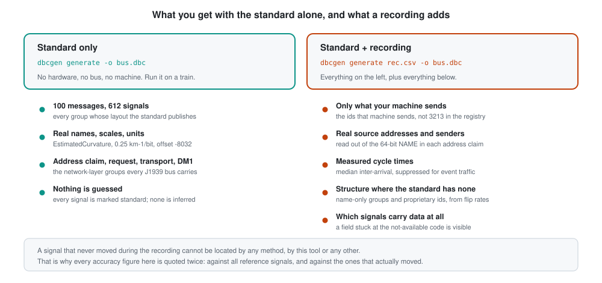
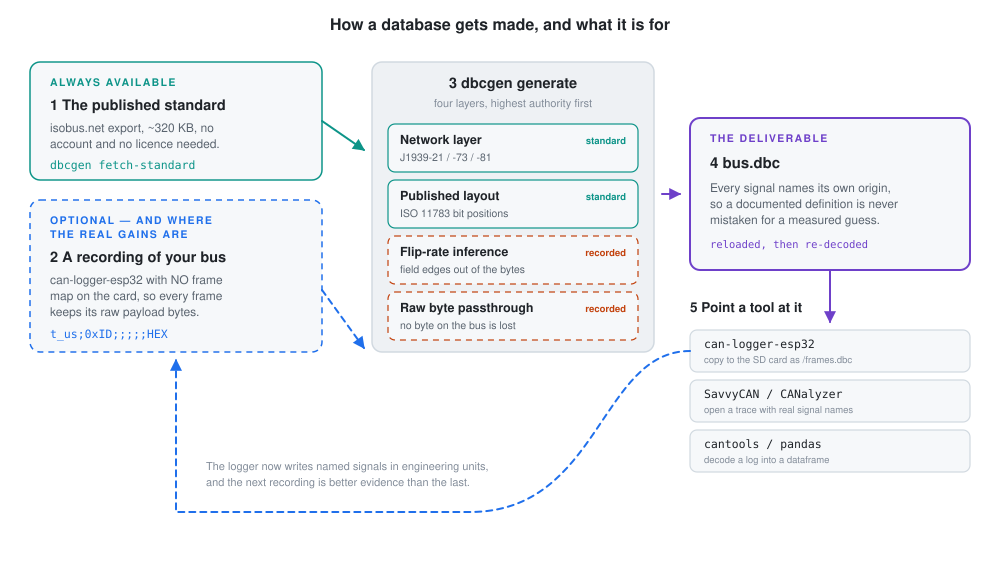
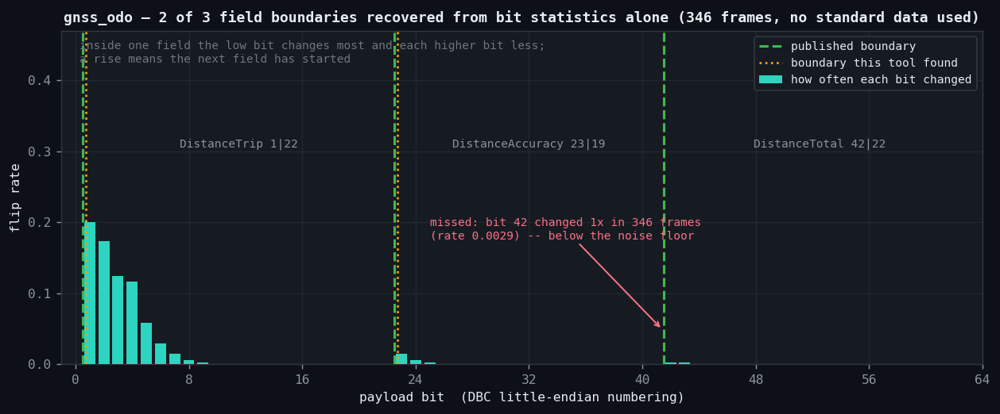

<h1 align="center">dbcgen</h1>
<p align="center"><i>Generate DBC files from published CAN standards, refined by recorded traffic</i></p>

<p align="center">
<a href="https://github.com/mhmmdbdrhmd/dbcgen/actions/workflows/tests.yml"></a>


</p>

> A DBC generator for J1939 and ISO 11783 (ISOBUS) buses. Run it with no
> recording and it compiles the **published standard** into a database: every
> parameter group whose bit layout is documented, with its real signal names,
> scales, offsets and units. Give it a **recording of your bus as well** and it
> narrows that database to the machine in front of you — real source addresses,
> real cycle times, and a measured field structure for the parameter groups the
> standard names but does not lay out.

> [!IMPORTANT]
> **The two halves of the output carry different weight, and the file says which
> is which.** Signals taken from the standard are exact — bit position, scale and
> unit are as documented, and producing them is a lookup, not a guess. Signals
> derived from traffic are measured at **about 69% exactly correct** on the buses
> where a public reference exists, and they carry no unit and no scale. Every
> signal name states which kind it is. → [§6](#6-what-the-names-mean),
> [§7](#7-results), [§10](#10-limitations)

<details open>
<summary><b>Contents</b></summary>
<br>

- [1. What it does](#1-what-it-does)
- [2. Quick start](#2-quick-start)
- [3. The workflow](#3-the-workflow)
- [4. Where the standard comes from](#4-where-the-standard-comes-from)
- [5. How it reads a payload](#5-how-it-reads-a-payload)
- [6. What the names mean](#6-what-the-names-mean)
- [7. Results](#7-results)
- [8. Command reference](#8-command-reference)
- [9. How it works](#9-how-it-works)
- [10. Limitations](#10-limitations)
- [11. Reproducing every number here](#11-reproducing-every-number-here)
- [12. Future development](#12-future-development)
- [License](#license)
- [Author](#author)

</details>

---

## 1. What it does

You have a vehicle bus and no database for it. Two partial routes exist, and the
useful tool is the one that runs both and keeps them apart.

**The published standard** is the primary source, and it is free. ISO 11783 and
the J1939 network-layer documents are public, and the ISOBUS registry publishes
them as a machine-readable export: 3,213 parameter groups, of which **102 carry
a full bit layout**. For those, building a database is a compilation problem
with an exact answer. `dbcgen` needs no hardware, no bus and no recording to
produce it.

**A recording** is the second source, and it answers what the standard cannot.
Which of those 3,213 groups does *this* machine actually send? Which ECU sends
each one, and how often? And — for the ~2,764 groups the standard names but whose
layout sits behind SAE's paywall, and for the proprietary identifiers no standard
describes at all — what is the field structure, measured from how the bytes
behave?

<p align="center">
  <picture>
    <source media="(prefers-color-scheme: dark)" srcset="docs/figures/inputs-dark.svg">
    
  </picture>
</p>

Generation is deterministic. The same recording and the same standard revision
always produce the same file, byte for byte, which is what makes a generated
database reviewable and diffable rather than something taken on trust.

---

## 2. Quick start

```bash
pip install -e ".[dev]"
dbcgen fetch-standard                      # ~323 KB, cached once, then offline
```

**With no bus in front of you** — a database of everything the standard lays out:

```bash
dbcgen generate -o standard.dbc
```
```
wrote standard.dbc  (no recording read)
  messages          : 100
    network layer   : 5
    standard layout : 95
  signals           : 612, all from the standard
  skipped           : 2760 PGN(s) the standard names but does not lay out, 6 multi-frame
```

**With a recording** — the same standard layer, narrowed to one machine and
extended by inference over the bytes:

```bash
dbcgen generate recording.csv -o bus.dbc
```
```
wrote bus.dbc
  messages          : 15
  signals           : 0 from the standard, 149 inferred from the recording
verify: 7611/7611 frames decoded
verify: PASS
```

`generate` reloads the file it just wrote and decodes the whole recording with
it. Anything short of every frame is a non-zero exit status — a database that
parses but cannot decode its own source recording is not finished.

To look before generating:

```bash
dbcgen inspect recording.csv               # ids, rates, cycle times, PGNs
```

---

## 3. The workflow

The database is the middle step of a loop, not an end in itself. This is the
whole journey; the point of the diagram is which parts are optional.

<p align="center">
  <picture>
    <source media="(prefers-color-scheme: dark)" srcset="docs/figures/workflow-dark.svg">
    
  </picture>
</p>

### 3.1 Stage 1 — the standard (always)

```bash
dbcgen fetch-standard
```

One public file, downloaded once and cached in `~/.cache/dbcgen/`, pinned by
sha256 so a later run can prove it used the same revision. No account, no
licence, no vendored copy in the repository. Every run after the first is
offline. → [§4](#4-where-the-standard-comes-from)

### 3.2 Stage 2 — record the bus (optional)

**You can skip this entirely.** Skipping it is not a degraded mode; it is the
standard-only mode, and everything it emits is exact. What you give up is
specificity — you get every parameter group the standard lays out, whether or
not your machine sends it, with a placeholder source address, no cycle times,
and nothing at all for the groups whose layout is paywalled.

If you do record, the reference recorder is
[**can-logger-esp32**](https://github.com/mhmmdbdrhmd/can-logger-esp32) — an
ESP32 and an MCP2515, whose CSV output `dbcgen` reads natively.

> **Record with no frame map on the card.** The logger decodes against a
> `/frames.dbc` if it finds one, and a decoded row carries a physical value
> *instead of* the payload bytes. Inference needs the bytes. Take the card's
> `frames.dbc` away — or use a card that never had one — so every frame is
> written raw:
>
> ```
> t_us;0xID;;;;;HEX
> 28870;0x1A0;;;;;01020304
> ```
>
> `dbcgen` detects a recording made *with* a frame map and says so, rather than
> quietly inferring from whatever fraction of the data still has payloads.

Any capture tool works in principle: the reader is chosen by looking at the file
rather than at its extension, HUD ECU Hacker HTML traces are read directly, and
`archive.zip::member.csv` is accepted anywhere a path is. The benchmark harness
additionally converts anything `python-can` reads — MF4, BLF, ASC, TRC, candump —
into the recorder's format.

**Recording quality dominates everything.** Ten minutes of a machine doing
varied work is worth more than any amount of algorithm, because a signal that
never moves during the recording cannot be located by any method. Drive it,
steer it, lift the implement, change gear.

### 3.3 Stage 3 — generate

```bash
dbcgen generate -o standard.dbc              # standard only
dbcgen generate recording.csv -o bus.dbc     # standard + recording
```

Four resolution layers run in order of authority, and each identifier is claimed
by the highest layer that can claim it:

| # | layer | source | needs a recording | marked |
|---|---|---|---|---|
| 1 | **Network layer** | J1939-21, -73, -81 — address claim, request, transport protocol, DM1 | no | `standard` |
| 2 | **Published layout** | the ISO 11783 bit positions in the registry export | no | `standard` |
| 3 | **Flip-rate inference** | field boundaries measured from how the payload bytes behave | **yes** | `inferred` |
| 4 | **Raw byte passthrough** | one 8-bit signal per byte, so nothing on the bus is silently dropped | **yes** | `inferred` |

Layers 1 and 2 are lookups with exact answers. Layers 3 and 4 exist only because
there is a recording to run them over — which is the whole of the difference
between the two commands above. → [§5](#5-how-it-reads-a-payload)

### 3.4 Putting the database to work

The output is an ordinary Vector `.dbc`. Three things to do with it:

| where | how |
|---|---|
| **can-logger-esp32** | copy it to the SD card as `/frames.dbc`. The logger then writes named signals in engineering units instead of hex, and the web dashboard shows whatever the database describes. |
| **SavvyCAN, CANalyzer, Vector tools** | open a trace with real signal names on it. |
| **cantools, python-can, pandas** | `cantools.database.load_file('bus.dbc')`, then decode a log into a dataframe. |

### 3.5 The loop

Stage 4 feeds stage 2. Once the logger carries the database, its recordings
arrive already labelled, which makes the *next* recording better evidence than
the last: you can see which signals are live, which are stuck at the standard's
"not available" code, and which identifiers are still nothing but
`Guess_24_16`. Anything the generator could not name is still present as a raw
field, so the map improves with each pass instead of having to be right the
first time.

<details>
<summary><b>Which route should you take?</b></summary>
<br>

| you have | do this | you get |
|---|---|---|
| Nothing but the knowledge that it is a J1939 or ISOBUS bus | `dbcgen generate -o standard.dbc` | 100 messages, 612 signals, all exact, all `standard`. A reference sheet and a starting point. Source addresses are placeholders — match on the PGN. |
| A recording, and no idea what the machine is | `dbcgen inspect rec.csv`, then `dbcgen generate rec.csv -o bus.dbc` | Only what that machine sends; real senders and cycle times; inferred structure for everything the standard leaves open. |
| A recording of an ISOBUS tractor | as above | The guidance, speed and distance groups come back with documented names, scales and units — ISO 11783 publishes those layouts in full. |
| A recording of a truck engine bus | as above | Parameter groups get their real names, but most of their *layouts* are SAE Digital Annex material, so their internals come back as `Guess_*`. That is the paywall showing, not a tool failure. |
| A licensed SAE J1939 Digital Annex | not yet — see [§12](#12-future-development) | The overlay that would close that gap is designed but not built. |

</details>

---

## 4. Where the standard comes from

One public file, fetched and cached — never vendored, so a generated database
can state which dated revision produced it.

| | |
|---|---|
| source | `https://www.isobus.net/isobus/attachments/isoExport_csv.zip` (323 KB, no auth) |
| contents | 17,518 SPNs across 3,213 PGNs, plus manufacturer, NAME-function, industry-group and source-address tables |
| full bit layout for | **1,269 SPNs across 102 PGNs** — the ISO 11783 parts |
| names only for | the other **2,764 PGNs**, whose layout is in the paid SAE Digital Annex |

`dbcgen fetch-standard` prints exactly this split for the cached copy, so the
numbers above are checkable rather than quoted.

**Why the split exists.** SAE moved the application-layer parameter tables out of
J1939-71 and into the Digital Annex in 2013. The free registry kept the *names*
and replaced each layout with a link to SAE's shop — `pgn_description` for PGN
61444 (electronic engine controller 1) literally reads *"See
https://www.sae.org/standards/content/j1939da_202412/ for details"*. The ISO
11783 parts were never moved, which is why agricultural and guidance groups come
back complete and truck engine groups do not.

The J1939-21/-73/-81 network-layer groups — address claim, request, transport
protocol, DM1 — are not tabulated in that export at all, because they belong to
the network-layer documents rather than the application-layer tables. Those
documents are freely published, and their layouts are encoded in
`src/dbcgen/standard/network_layer.py`, each citing the part that defines it.

<details>
<summary><i>what a standard-only database actually looks like</i></summary>
<br>

```bash
dbcgen generate --pgn 44032 -o gms.dbc
```
```
BO_ 2360147966 GMS_FE: 8 Vector__XXX
 SG_ EstimatedCurvature : 0|16@1+ (0.25,-8032) [-8032|8031.75] "km-1"  Vector__XXX
 SG_ MechanicalSystemLockout : 16|2@1+ (1,0) [0|3] ""  Vector__XXX
 SG_ GuidanceSteeringSystemReadiness : 18|2@1+ (1,0) [0|3] ""  Vector__XXX
 SG_ SteeringInputPositionStatus : 20|2@1+ (1,0) [0|3] ""  Vector__XXX
 SG_ RequestResetCommandStatus : 22|2@1+ (1,0) [0|3] ""  Vector__XXX
 SG_ GuidanceLimitStatus : 29|3@1+ (1,0) [0|7] ""  Vector__XXX
```

No recording was involved in any line of that. The scale, the offset, the range
and the unit are the published ones.

`0xFE` in the identifier is the J1939 null address, used here as a placeholder —
the standard defines parameter groups, not which ECU sends them. Match on the
PGN rather than on the whole 29-bit identifier, or pass a recording to resolve
the real addresses. `--source-address` overrides it.

</details>

---

## 5. How it reads a payload

This is the part that runs only when there is a recording.

Inside one little-endian integer field the lowest bit changes most often and each
higher bit about half as often as the one below. Where a new field begins, its
own low bit changes often again. **So the boundaries between fields are the bit
positions where the flip rate rises** — and that works without byte alignment,
which is where byte-oriented methods fail.

<p align="center">
  
</p>

That message packs a 1-bit flag and three fields of 22, 19 and 22 bits, none
byte-aligned. Two of the three interior boundaries fall out of the bit statistics
alone. The third does not, and the figure says why: that bit changed once in 346
frames, which is not distinguishable from a stuck bit.

Regenerate it with `python docs/make_figures.py`.

---

## 6. What the names mean

The prefix is the warning. It survives export, copy-paste, and tools that hide
comments — which a `CM_` comment does not.

| name | means |
|---|---|
| `EstimatedCurvature` | from the published standard. Bit position, scale and unit are as documented. Trust these. |
| `Guess_24_16` | inferred from one recording. Start bit 24, length 16. Scale 1, no unit, meaning unknown. |
| `Const_40_8` | these bits never changed during the recording — a fact about the recording, not proof they are constant. |
| `Raw_Byte3` | no structure inferred; the byte is passed through so nothing is silently dropped. |

Every signal also carries a `CM_` comment with the statistic behind it, and a
`SignalSource` attribute (`standard` / `convention` / `inferred` / `proposed`) so
a tool can filter on provenance without parsing text. Every generated file opens
with a plain-language warning block explaining exactly the table above.

```
BO_ 2364539904 EEC1_00: 8 Engine_00          BO_ 2360089386 GMS_2A: 8 SteeringController_2A
 SG_ Guess_0_8  : 0|8@1+ (1,0)                SG_ EstimatedCurvature : 0|16@1+ (0.25,-8032) "km-1"
 SG_ Const_8_8  : 8|8@1+ (1,0)                SG_ MechanicalSystemLockout : 16|2@1+ (1,0)
 SG_ Guess_16_8 : 16|8@1+ (1,0)               SG_ GuidanceSteeringSystemReadiness : 18|2@1+ (1,0)
 SG_ Guess_24_16: 24|16@1+ (1,0)   <- engine speed, right bits, no name
```

Left: a truck engine group. Its *name* comes from the standard; its internals do
not, because that layout is Digital Annex material. Right: an ISOBUS guidance
group, published in full. Same generator, same run — the difference is entirely
what the free standard contains.

---

## 7. Results

The standard layer needs no scoring: it is a lookup, and the test suite asserts
that generating PGN 44032 reproduces the published `EstimatedCurvature`
definition exactly, with and without a recording.

The **inference layer** is the part that can be wrong, so it is measured against
reference databases published by someone else — the MIT-licensed logs and DBCs in
[CSS-Electronics/api-examples](https://github.com/CSS-Electronics/api-examples).
The generator never sees the reference.

| | gnss<br><sub>19 msgs / 221 signals</sub> | j1939-truck<br><sub>145k frames</sub> |
|---|---|---|
| message recall | 100% | 100% |
| exact signal match <sub>start+length+order+sign</sub> | **61.5%** <sub>24/39</sub> | 16.7% <sub>1/6</sub> |
| — of signals that actually moved | **69.2%** <sub>18/26</sub> | 50% <sub>1/2</sub> |
| value recoverable <sub>identical raw values</sub> | 79.5% <sub>31/39</sub> | 16.7% <sub>1/6</sub> |
| mean bit overlap (Jaccard) | 76.9% | 54.5% |
| precision <sub>exact / signals emitted</sub> | 68.6% | 2.6% |

```bash
python -m benchmarks.run          # downloads the data, prints this table
```

**Read the second row, not the first.** 13 of the 39 gnss reference signals and 4
of the 6 J1939 ones held a single value for the whole recording. Nothing can
locate a signal that never moved, so counting those as misses measures the
recording rather than the method. Both denominators are reported; the difference
between them is itself worth knowing.

The `j1939-truck` reference defines only two signals, so its column is an
anecdote with a decimal point and is shown for honesty, not as a result. What it
does establish is that the published `EngineSpeed` position (`24|16`) is
recovered from the bytes alone, with no standard data involved.

Precision is reported because a tool can score well on recall by emitting every
possible field. 2.6% on the truck reflects a reference that names 2 signals
against a bus carrying hundreds.

---

## 8. Command reference

<details>
<summary><i>expand</i></summary>
<br>

```
dbcgen fetch-standard [--refresh]
```

Download and cache the public ISOBUS/J1939 export, then print its coverage
split. Run once; every later command is offline unless `--refresh` is given.

```
dbcgen inspect <recording> [--json]
```

Report what is on the bus without generating anything: every identifier, its
frame count and rate, DLC, median cycle time, whether it is cyclic, its PGN and
source address, how many distinct payloads it carried, and how many of its bits
ever moved. `--json` for a machine-readable form.

```
dbcgen generate [recording] -o <out.dbc>
                [--pgn N]... [--source-address SA]
                [--version STR] [--refresh-standard] [--no-verify]
```

With a `recording`, build from the standard *and* the traffic. Without one,
build from the standard alone.

| flag | effect |
|---|---|
| `--pgn N` | standard-only: restrict output to these PGNs. Decimal or `0x` hex, repeatable, comma-separated. |
| `--source-address SA` | standard-only: the placeholder source address identifiers are built from. Default `0xFE`, the J1939 null address. |
| `--version STR` | the `VERSION` string written into the file. |
| `--refresh-standard` | re-download the export before generating. |
| `--no-verify` | skip reloading the result and decoding the recording with it. Verification is on by default, and its failure is a non-zero exit. |

**Recording formats.** can-logger-esp32 CSV and HUD ECU Hacker HTML, chosen by
content rather than by file extension. `archive.zip::member.csv` is accepted
anywhere a path is, because recordings are routinely shipped zipped and are often
too large to unpack.

</details>

---

## 9. How it works

<details>
<summary><i>the pipeline, highest authority first</i></summary>
<br>

1. **Read** the recording into frames, grouped by the whole 29-bit identifier —
   source address included, which is what a DBC consumer matches on. One
   parameter group from two ECUs is two messages. (Skipped entirely in
   standard-only mode, which iterates the standard's parameter groups instead.)
2. **Network layer.** Address claim, request, transport protocol and DM1 get the
   layouts J1939-21/-73/-81 publish.
3. **Standard layout** where the export provides one, emitted verbatim with the
   SPN number attached.
4. **Inference** for everything else — see below. Recording only.
5. **Emit and verify**: write the DBC as text, reload it with `cantools`, decode
   the entire source recording with it.

</details>

<details>
<summary><i>the inference engine</i></summary>
<br>

Two field types are found first, by behaviour, because both mimic the low bits of
a fast signal and would wreck the segmentation if left in place:

- **rolling counter** — increments modulo *n* and wraps. Includes the masked
  `0xF0 | n` form, found without being told the bus uses it.
- **checksum** — near-random, every bit balanced, at the tail of the payload.

Then the flip-rate boundaries, with three corrections that each exist because of
a specific failure:

- **Sampling noise.** A rise counts only if it clears four standard errors of the
  rate estimate. Without this, neighbouring bits of one field split apart.
- **Saturation.** Once a bit changes about half the time, every bit below it is
  effectively random and their order carries no information. Rises inside that
  region are noise wearing structure, and acting on them splits one fast signal
  into several.
- **Constant tails and late boundaries.** A signal's unused high bits look
  identical to padding, and a low bit that never moves shifts the boundary one or
  two bits late. Both are corrected — but only in messages whose boundaries are
  already mostly byte-aligned. In a packed layout the same corrections destroy
  correct answers, and the message itself says which kind it is.

**Nothing here invents scaling.** An inferred field keeps factor 1 and offset 0.
A recording shows what the bits do, not what unit they are in.

</details>

<details>
<summary><i>node identity</i></summary>
<br>

Source addresses are named from the ECUs' own Address Claimed frames: the 64-bit
J1939 NAME decoded against the manufacturer and function tables, so a node is
called what it says it is rather than what it appeared to do. With no recording
there are no address claims, so a standard-only database has no node list and a
placeholder source address.

</details>

---

## 10. Limitations

<details open>
<summary><i>the ones that will bite you first</i></summary>
<br>

- **Most J1939 layouts are paywalled, and no tool changes that.** 2,764 of the
  3,213 parameter groups come back as a name and nothing else. A recording
  recovers *structure* for them, never meaning. If your bus is a truck engine
  bus, expect real names on the messages and `Guess_*` inside them.
- **A signal that never moves cannot be found.** Not "is hard to find" — the
  recording contains no evidence of where its boundaries are. On the gnss
  benchmark that is 13 of 39 reference signals.
- **~69% exact is not 100%.** Roughly three in ten recoverable signals get the
  wrong boundaries. Treat the inferred half of a generated database as a strong
  starting point for a human, not as a finished map. The standard half needs no
  such caveat.
- **Scale, offset and unit are never inferred**, only ever taken from the
  standard. An inferred 16-bit field is a raw count with no unit.

</details>

<details>
<summary><i>the rest, in full</i></summary>
<br>

- **A field whose bits change more often than the field above it merges with
  it.** Boundaries are found where the rate *rises*; this case produces a fall.
  Usually the fast field is a counter or a flag, both caught earlier — where it
  is neither, the boundary is invisible. Recorded in
  `tests/test_infer.py::test_a_field_below_a_faster_one_cannot_be_separated_from_it`.
- **Big-endian fields are under-detected.** Byte order is reconsidered only for
  byte-aligned fields of 16 bits or more, *after* segmentation, and segmentation
  itself runs in little-endian bit order. A Motorola field spanning bytes 0–1 is
  cut at bit 8. Fixing this needs a second segmentation pass in big-endian order.
- **Multi-packet parameter groups are not reassembled yet.** Transport-protocol
  frames are decoded individually; the payload they carry is not yet joined up,
  so a parameter group longer than 8 bytes is not decoded. In standard-only mode
  those 6 groups are skipped rather than emitted as something a classical CAN
  frame could never carry.
- **Standard-only identifiers are placeholders.** The standard defines parameter
  groups, not senders. A standard-only database will not match live traffic on
  the full 29-bit identifier — match on the PGN, or regenerate from a recording.
- **A recording made *with* a frame map is close to useless here**, because the
  decoded rows no longer carry payload bytes. The reader detects this and warns
  rather than inferring from whatever fraction survived.
- **The round trip onto the logger is not covered by CI.** The generated file is
  reloaded and re-decoded with `cantools` on every run, which is a stricter
  reader than most consumers; copying it onto a can-logger-esp32 SD card is
  described in [§3.4](#34-putting-the-database-to-work) and has not been
  made part of an automated test.

</details>

---

## 11. Reproducing every number here

```bash
pip install -e ".[dev]"
PYTEST_DISABLE_PLUGIN_AUTOLOAD=1 pytest -q      # 125 tests
dbcgen fetch-standard                           # the standard-coverage split
dbcgen generate -o /tmp/standard.dbc            # 100 messages, 612 signals
python -m benchmarks.run                        # the results table
python docs/make_figures.py                     # the segmentation figure
python docs/make_workflow.py                    # the workflow diagrams
```

CI runs the suite on Python 3.10 → 3.13.

---

## 12. Future development

<details>
<summary><i>expand</i></summary>
<br>

None of this is committed to. It is written down because the design decisions
that make each one cheap or expensive are already made.

- **Reconcile inferred fields against name-only SPN lists.** For the 2,764
  paywalled groups the export still gives the *ordered list of parameters* each
  one contains. Where inference finds the same number of fields in the same
  order, mapping those names onto them is a proposal worth making — emitted as
  `proposed`, never promoted to `standard`. This is the highest-value piece of
  work left, because it is what would put real names on truck buses.
- **A licensed Digital Annex overlay.** For anyone who holds a licence, the
  layouts they paid for should slot in as a `standard` source. Designed as a
  gitignored local file, never vendored, so the repository stays clean of
  licensed material.
- **Transport-protocol reassembly.** Join TP.CM and TP.DT sessions into virtual
  multi-packet messages, which is the only way software identification (PGN
  65242, routinely over 100 bytes) is ever recovered.
- **Cross-identifier correlation.** Pearson *r* and least-squares gain between
  candidate signals on different identifiers, to flag duplicates, scaled copies
  and inverted copies, annotating each with the fitted gain and the correlation
  it was fitted at. Cheap to compute, and often the fastest route to
  understanding what a proprietary group is for.
- **A second segmentation pass in big-endian bit order**, scored against the
  little-endian one per message. Closes the known Motorola gap in
  [§10](#10-limitations).
- **`VAL_` tables for inferred discrete fields.** A 2- or 3-bit field with few
  distinct values is almost always a status, and J1939's SLOT conventions
  already name the common ones.
- **Merge several recordings of one machine.** Signals that were constant in one
  session move in another, and the observable set is the union of the two. Today
  each run sees one file.

</details>

---

## License

MIT — see [LICENSE](LICENSE).

## Author

**Mohammad Badri Ahmadi** — embedded systems & on-device AI

<br><br>

<div align="center"><p align="center">
    &nbsp;&nbsp;&nbsp;&nbsp;&nbsp;
    <a href="mailto:contact@biss.qzz.io" style="text-decoration: none;" alt="Email">
        
    </a>&nbsp;&nbsp;&nbsp;&nbsp;&nbsp;
    <a href="https://github.com/mhmmdbdrhmd" style="text-decoration: none;" alt="GitHub">
        
    </a>&nbsp;&nbsp;&nbsp;&nbsp;&nbsp;
    <a href="https://www.linkedin.com/in/mohamad-badri-ahmadi-aa2a1a8a" style="text-decoration: none;" alt="LinkedIn">
        
    </a>&nbsp;&nbsp;&nbsp;&nbsp;&nbsp;
  <a href="https://twitter.com/mhmmdbdrhmd" style="text-decoration: none;" alt="Twitter">
        
    </a>
    &nbsp;&nbsp;&nbsp;&nbsp;&nbsp;
  <a href="https://biss.qzz.io" style="text-decoration: none;" alt="Website">
        
    </a>
    &nbsp;&nbsp;&nbsp;&nbsp;&nbsp;
</p></div>
